# Awesome DateTime Picker

[](https://pub.dev/packages/awesome_datetime_picker)
[](https://github.com/inesachour/awesome_datetime_picker/actions/workflows/ci.yml)

iOS-style **wheel pickers** for Flutter: a date picker, a time picker, a date-time picker, a date-range picker and a duration picker, plus ready-made bottom sheets and dialogs. They work on every platform (iOS, Android, web, desktop), follow your light or dark theme, and can be customized down to the shape of the selector.

<p align="center">
  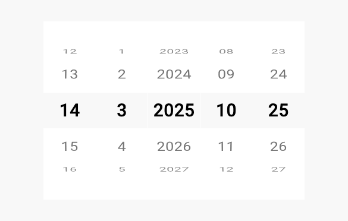
</p>

<p align="center">
  <b><a href="https://inesachour.github.io/awesome_datetime_picker/">Try it in your browser</a></b>
  (the <a href="example">example app</a>, with switches for dark mode, languages, exclusions and more)
</p>

## Features

- **Five pickers**: date, time, date-time, date range, duration, and the `showAwesome...Picker` functions that open any of them in a bottom sheet or a dialog with Cancel and Done.
- **Limits and exclusions**: minimum and maximum, excluded weekdays, specific dates (holidays), hours, or any rule through a predicate. Excluded values are removed from the wheels, or shown dimmed.
- **Time your way**: 12-hour or 24-hour clock, optional seconds, and minute and second intervals (every 5, 15, 30 minutes...).
- **More date formats**: day-month-year in any order, month and year only (card expiry), day and month only (birthdays), weekday labels ("Mon 12").
- **Localization**: six built-in languages, and any language of [`intl`](https://pub.dev/packages/intl) with its own digits (`fa`, `ar_EG`, ...).
- **Light and dark** automatically; a theme for the whole app (`AwesomePickerThemeData`), per-wheel themes, style presets (`ios`, `material`, `minimal`), wheel curvature, magnification, custom selector, looping wheels, haptic feedback, large-text support.
- **Controllers** (like `TextEditingController`) to read and set the selection from code.
- **Accessible and cross-platform**: screen readers announce and adjust each wheel ("Day, 15"), the keyboard works on every wheel, and wheels can be dragged with a mouse or trackpad on the web and on desktop.

## Gallery

<table>
  <tr>
    <td align="center">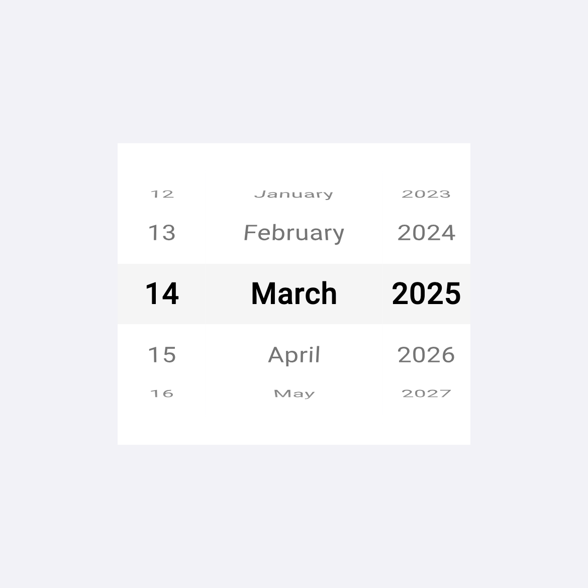<br><sub>Date picker</sub></td>
    <td align="center">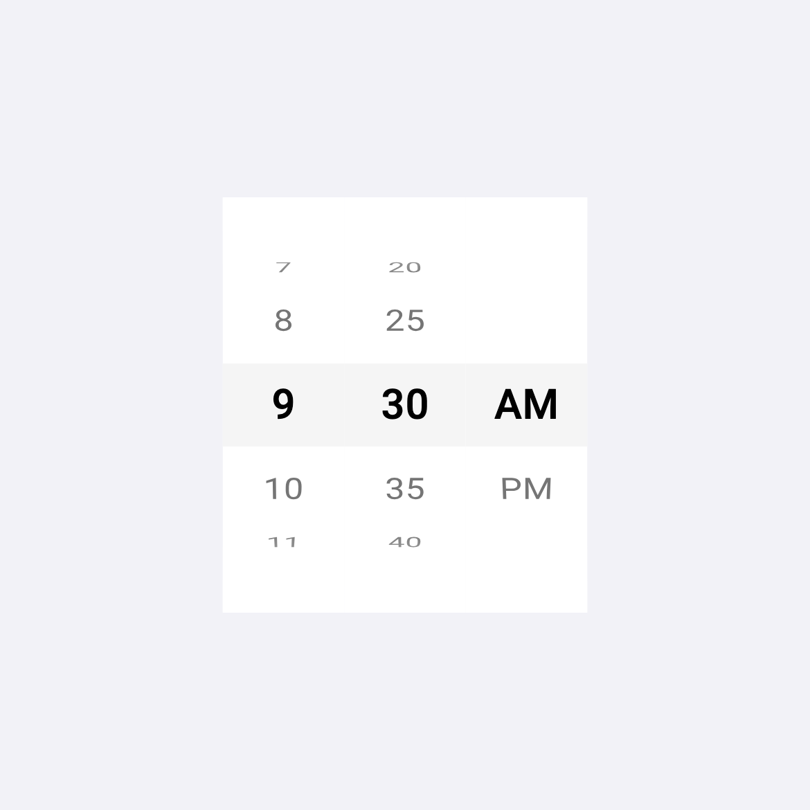<br><sub>Time picker, 12-hour, 5-minute steps</sub></td>
    <td align="center">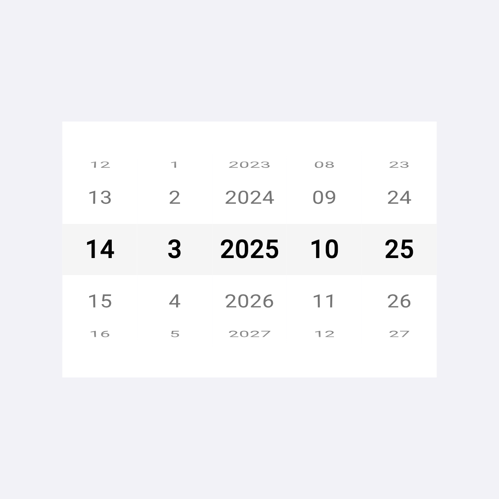<br><sub>Date-time picker</sub></td>
  </tr>
  <tr>
    <td align="center">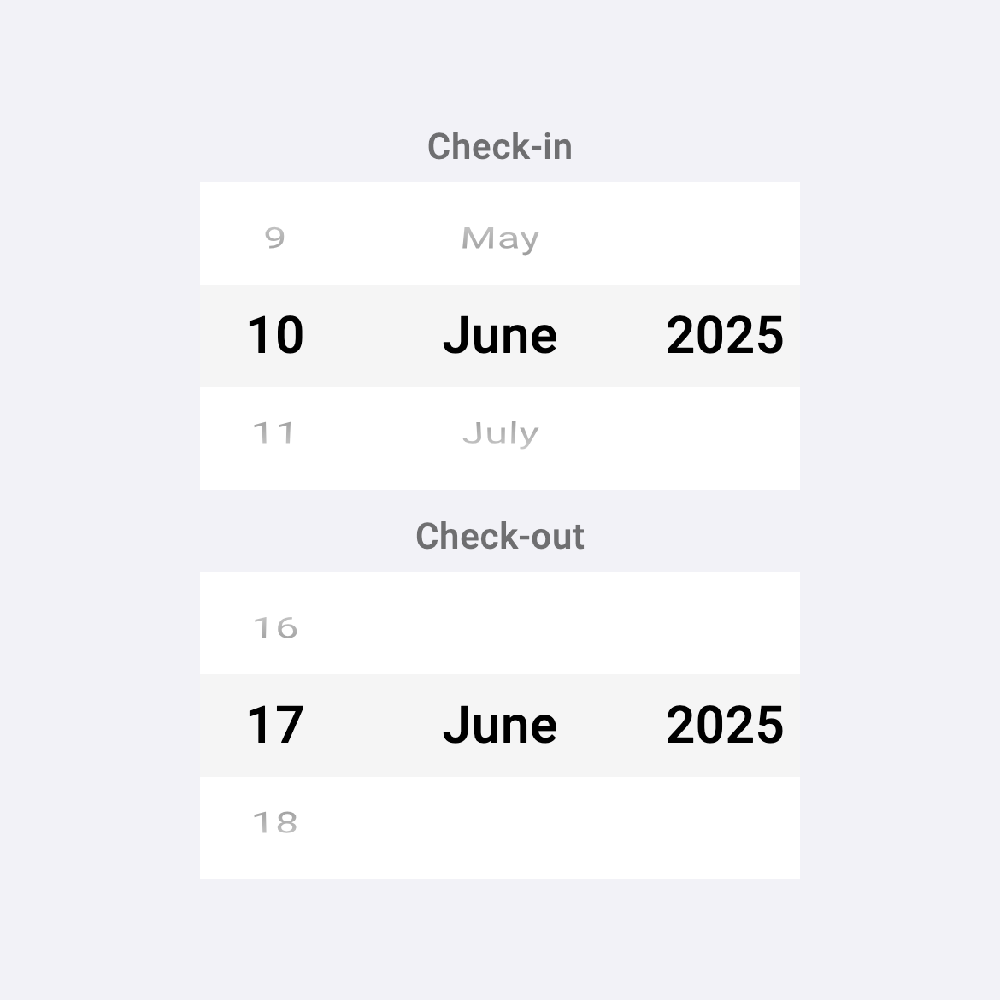<br><sub>Date range picker</sub></td>
    <td align="center">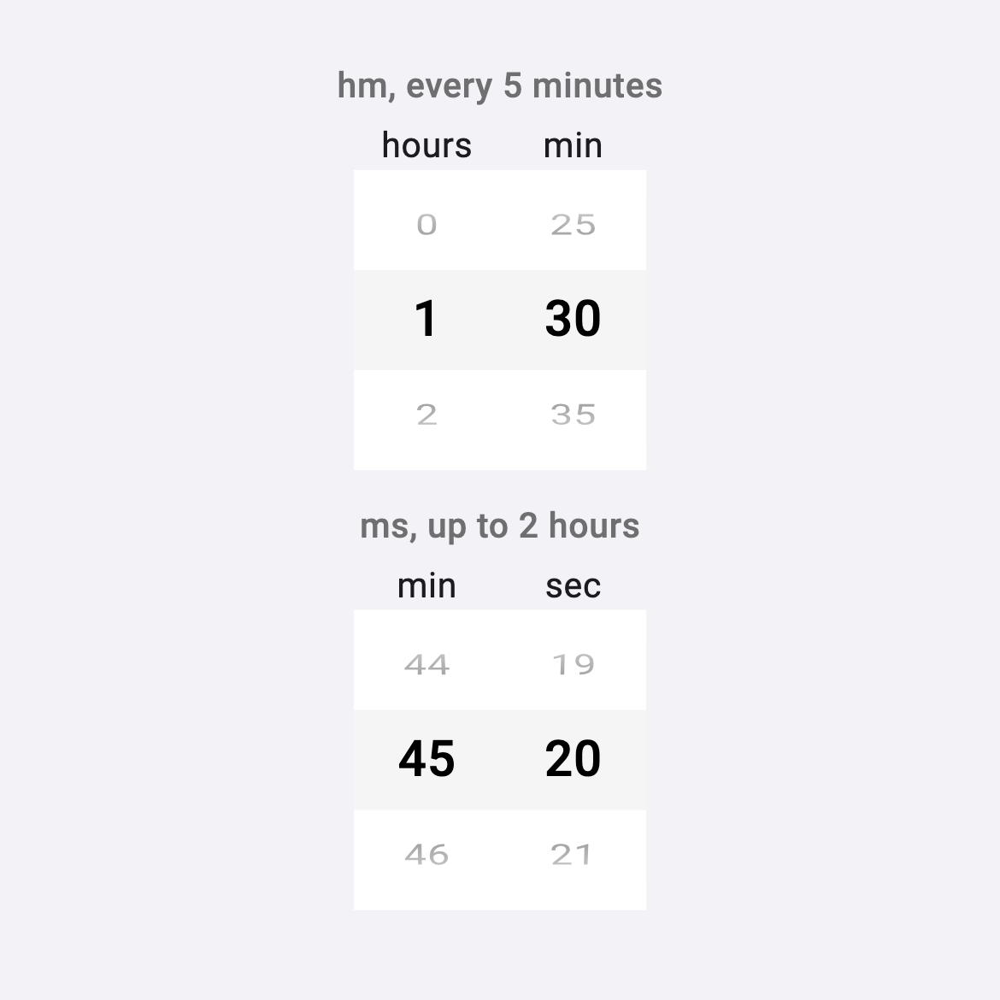<br><sub>Duration pickers</sub></td>
    <td align="center">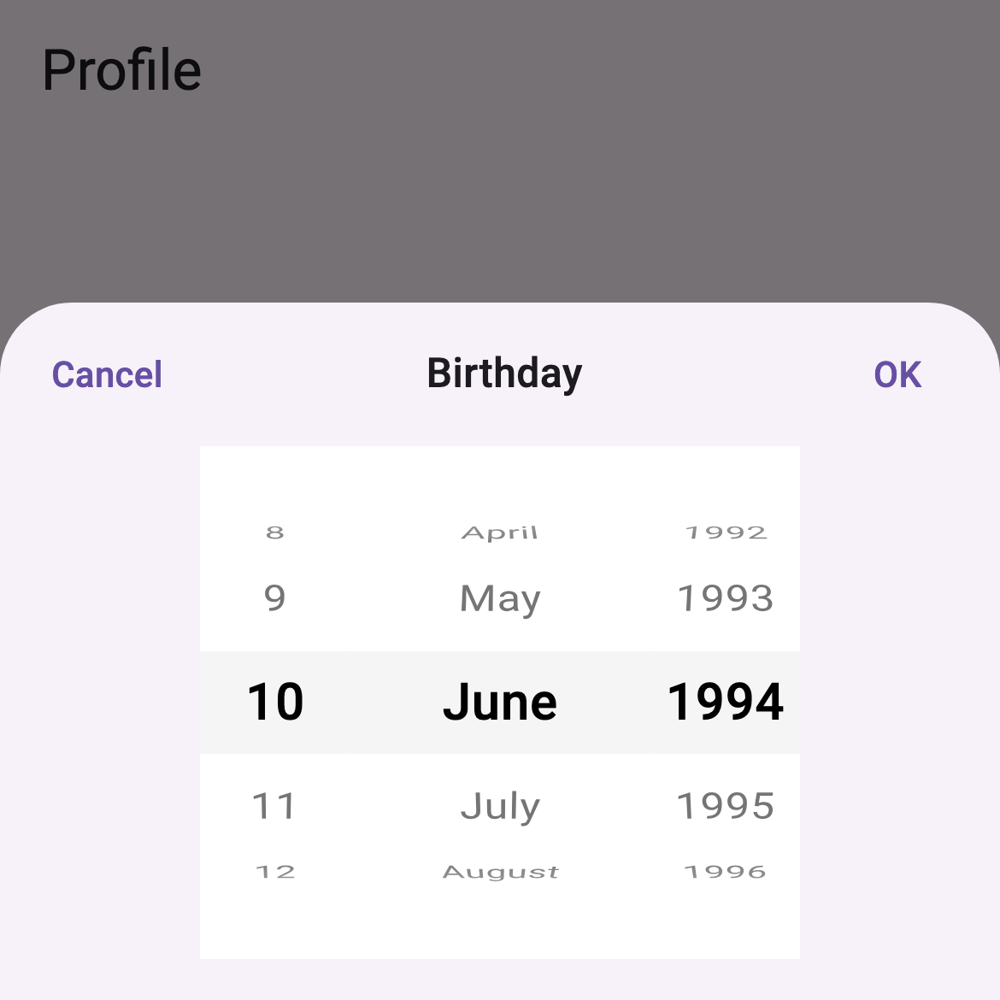<br><sub>In a bottom sheet</sub></td>
  </tr>
  <tr>
    <td align="center">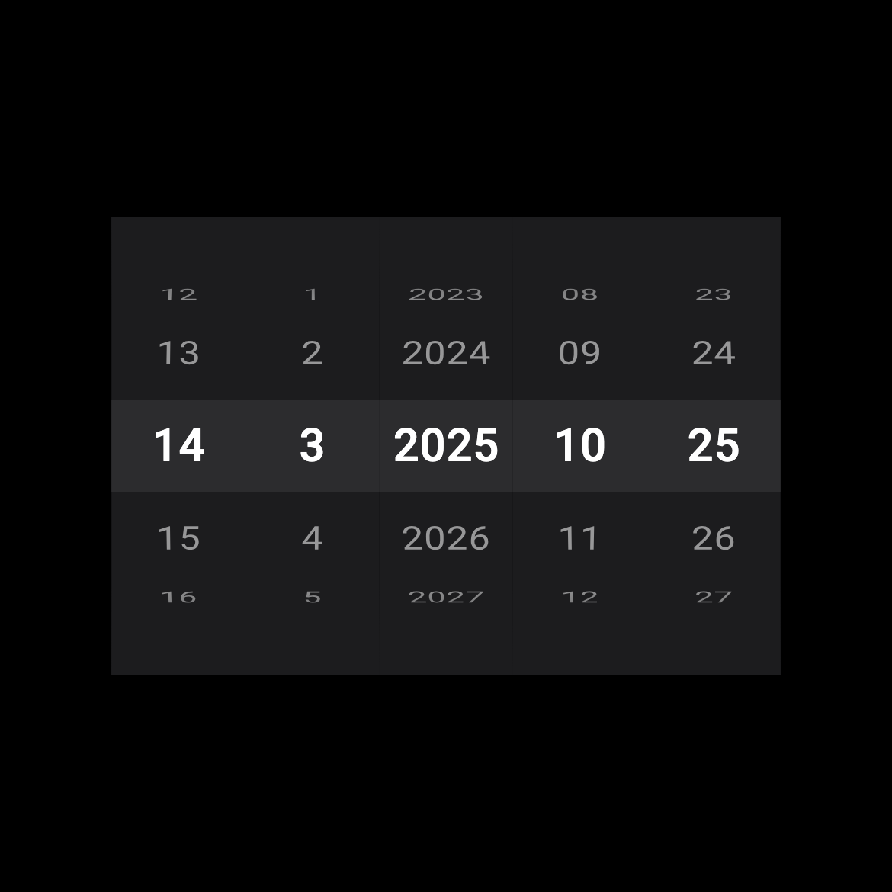<br><sub>Dark mode</sub></td>
    <td align="center">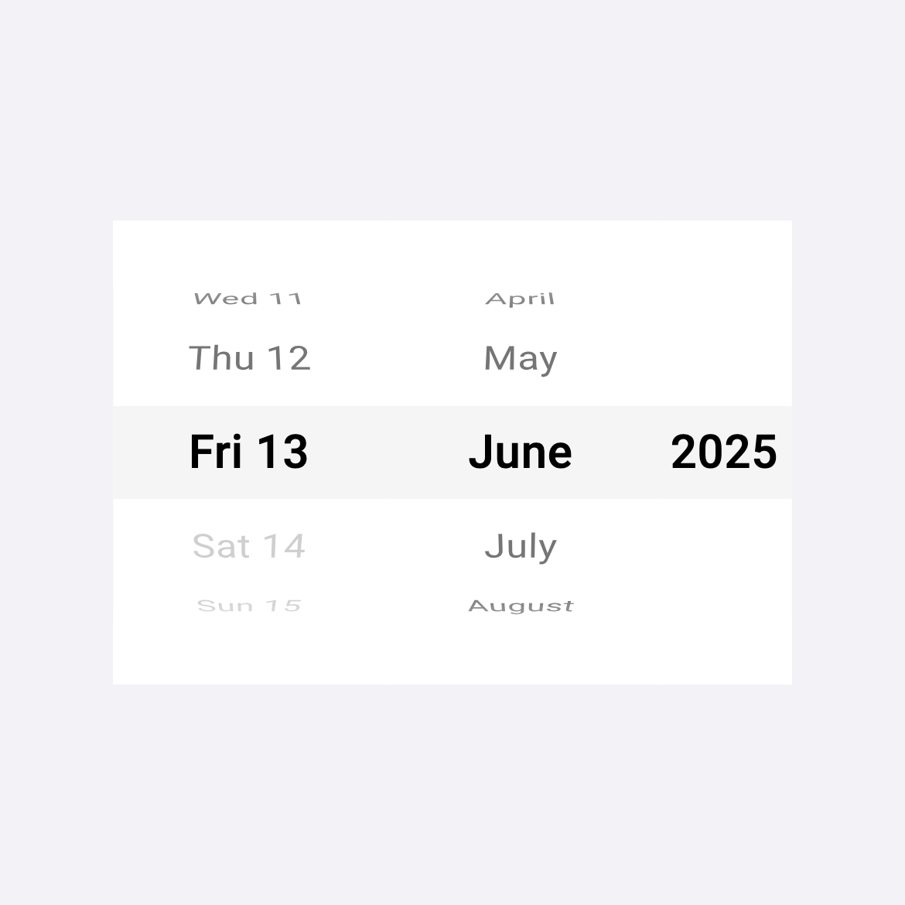<br><sub>Excluded weekends shown dimmed</sub></td>
    <td align="center">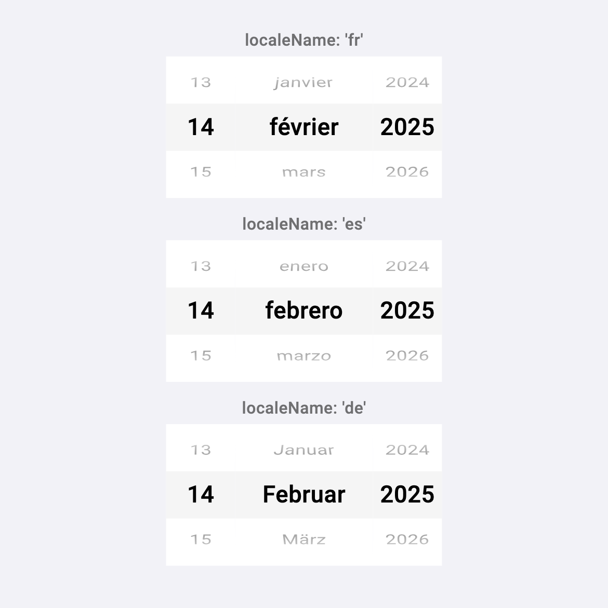<br><sub>Localization</sub></td>
  </tr>
  <tr>
    <td align="center">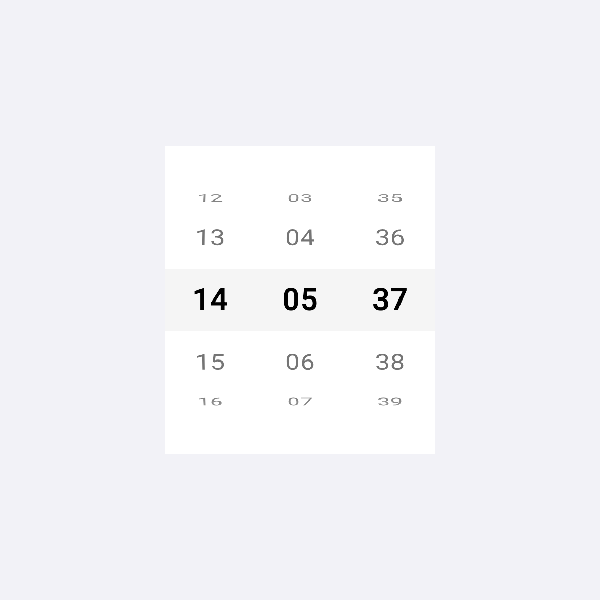<br><sub>With seconds</sub></td>
    <td align="center">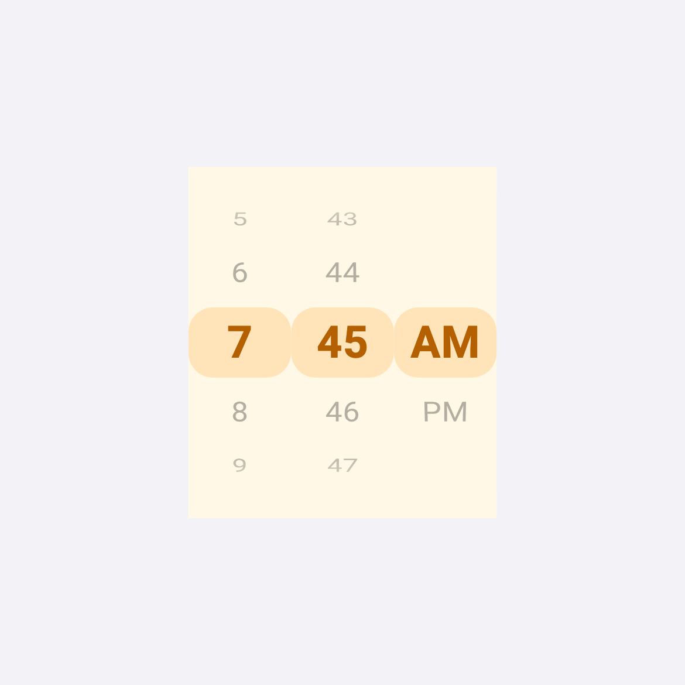<br><sub>Custom wheel style</sub></td>
    <td align="center">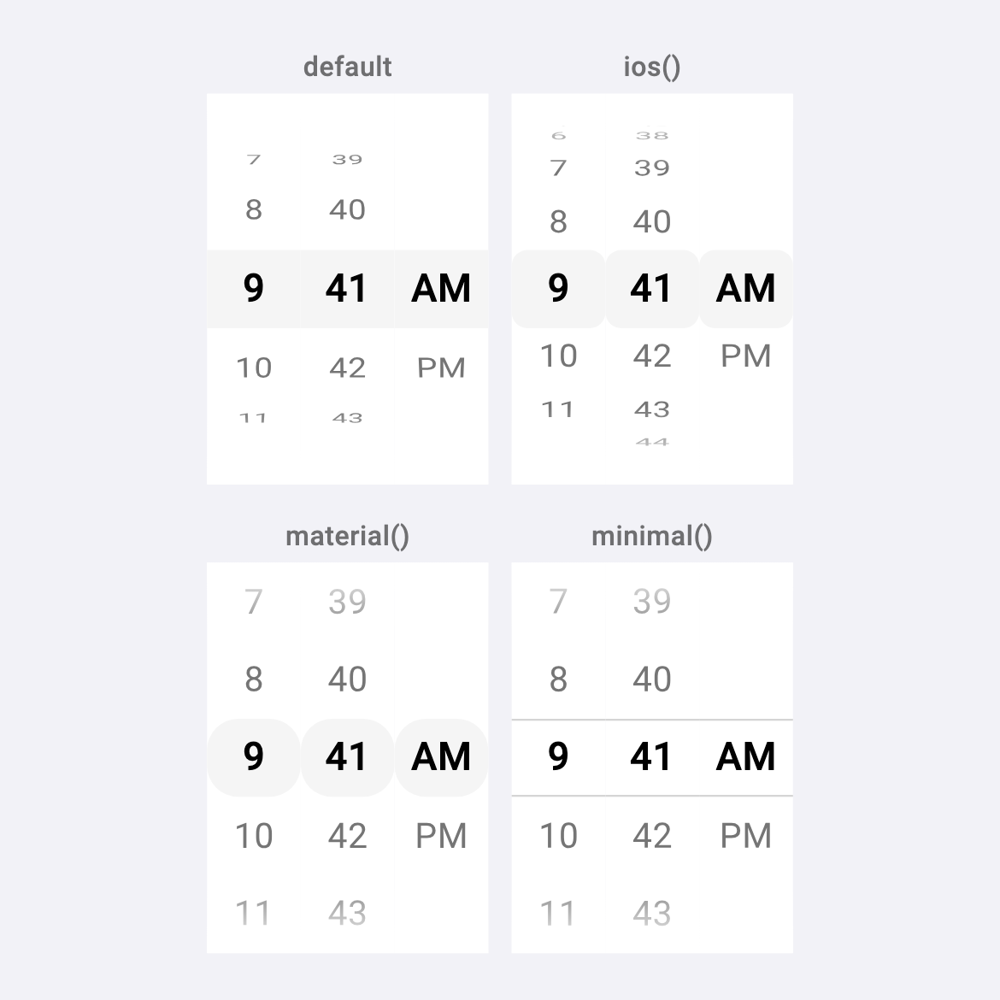<br><sub>Style presets</sub></td>
  </tr>
</table>

<sub>The images are rendered from the real widgets by `tool/generate_screenshots_test.dart`, with the Roboto font bundled with Flutter (an iOS device shows the system font).</sub>

## Contents

- [Installation](#installation)
- [Quick start](#quick-start)
- [The pickers](#the-pickers) and [their options](#options)
- [Showing a picker in a modal](#showing-a-picker-in-a-modal)
- [Controllers](#controllers)
- [Excluding values](#excluding-values)
- [Time: formats, seconds and intervals](#time-formats-seconds-and-intervals)
- [Date formats and weekday labels](#date-formats-and-weekday-labels)
- [Localization](#localization)
- [Appearance](#appearance)
- [Behavior to know about](#behavior-to-know-about)
- [Accessibility and platforms](#accessibility-and-platforms)
- [Upgrading from 0.1.x](#upgrading-from-01x)
- [Contributing](#contributing)

## Installation

```yaml
dependencies:
  awesome_datetime_picker: ^0.2.0
```

```dart
import 'package:awesome_datetime_picker/awesome_datetime_picker.dart';
```

Requires Dart 3.3.1 or newer.

## Quick start

Every parameter is optional. Without limits, a picker offers dates from 1900 to 2100 and starts on today (or the closest allowed value).

**In your layout:**

```dart
AwesomeDatePicker(
  onChanged: (AwesomeDate date) => print(date),
)
```

**In a bottom sheet**, which returns the chosen value (or `null` if the user cancels):

```dart
final date = await showAwesomeDatePicker(
  context,
  title: Text('Birthday'),
  maxDate: AwesomeDate(year: 2025, month: 12, day: 31),
);
```

**Driven from code** with a controller:

```dart
final controller = AwesomeTimePickerController(
  initialValue: AwesomeTime(hour: 9, minute: 30),
);

AwesomeTimePicker(controller: controller, minuteInterval: 15);

controller.value = AwesomeTime(hour: 14, minute: 0); // the wheels move
print(controller.value); // always what the wheels show
```

## The pickers

| Widget | Selects | Value type | In a modal |
|--------|---------|-----------|------------|
| `AwesomeDatePicker` | a date | `AwesomeDate` | `showAwesomeDatePicker` |
| `AwesomeTimePicker` | a time of day | `AwesomeTime` | `showAwesomeTimePicker` |
| `AwesomeDateTimePicker` | a date and a time | `AwesomeDateTime` | `showAwesomeDateTimePicker` |
| `AwesomeDateRangePicker` | a start and an end date | `AwesomeDateRange` | `showAwesomeDateRangePicker` |
| `AwesomeDurationPicker` | a length of time (timer, workout...) | `Duration` | `showAwesomeDurationPicker` |

The value types are small immutable classes: `AwesomeDate(year:, month:, day:)`, `AwesomeTime(hour:, minute:, second:)` (24-hour clock, `second` defaults to 0), `AwesomeDateTime(date:, time:)` and `AwesomeDateRange(start:, end:)`. All have `copyWith`, `==`, and `toDateTime()` where it makes sense; `AwesomeDateRange` also has `lengthInDays` and `contains(date)`.

They convert to and from Flutter's own types:

```dart
AwesomeDate.today();                         AwesomeDate.fromDateTime(DateTime.now());
AwesomeTime.now();                           AwesomeTime.fromDateTime(dateTime);
AwesomeTime.fromTimeOfDay(timeOfDay);        awesomeTime.toTimeOfDay();      // drops the seconds
AwesomeDateTime.now();                       AwesomeDateTime.fromDateTime(dateTime);
awesomeDate.toDateTime();                    awesomeDateTime.toDateTime();
```

### The date-time picker

The times offered depend on the selected date: on the day of `minDateTime` only times from its time are offered, on the day of `maxDateTime` only times up to its time, and any time in between.

```dart
AwesomeDateTimePicker(
  minDateTime: AwesomeDateTime(
    date: AwesomeDate(year: 2025, month: 12, day: 1),
    time: AwesomeTime(hour: 8, minute: 0),
  ),
  maxDateTime: AwesomeDateTime(
    date: AwesomeDate(year: 2025, month: 12, day: 31),
    time: AwesomeTime(hour: 18, minute: 0),
  ),
  timeFormat: AwesomeTimeFormat.hm,
  onChanged: (dateTime) => print(dateTime),
)
```

### The date-range picker

Two date pickers that stay consistent: the end is never before the start, and moving the start past the end moves the end along.

```dart
AwesomeDateRangePicker(
  minLength: 1, // at least one night
  maxLength: 14, // at most two weeks
  startLabel: Text('Check-in'),
  endLabel: Text('Check-out'),
  onChanged: (range) => print('${range.start} to ${range.end}'),
)
```

- `minLength` and `maxLength` limit the number of days between the two dates. When the start moves so that the end would break a limit, the end follows it.
- Exclusions apply to both dates. If they leave a start date without any selectable end date, the picker moves to the nearest start that has one.
- `onChanged` receives the whole range every time the user changes it, including when the end moved because of the start, so the last reported value is always the range shown.
- `direction: Axis.horizontal` puts the two pickers side by side.

### Options

A ✓ means the picker has the option. The API documentation describes each one in detail.

| Option | Date | Time | Date-time | Range | Duration | What it does |
|--------|:----:|:----:|:---------:|:-----:|:--------:|--------------|
| `initialDate`, `initialTime`, `initialDateTime`, `initialRange`, `initialDuration` | ✓ | ✓ | ✓ | ✓ | ✓ | Value shown first (default: now, within the limits; zero for a duration). Read once. |
| `minDate`/`maxDate`, `minTime`/`maxTime`, `minDateTime`/`maxDateTime`, `minDuration`/`maxDuration` | ✓ | ✓ | ✓ | ✓ | ✓ | Limits (the range picker uses `minDate`/`maxDate`). |
| `controller` | ✓ | ✓ | ✓ | ✓ | ✓ | Read and set the value from code. |
| `onChanged` | ✓ | ✓ | ✓ | ✓ | ✓ | Called when the *user* changes the value. |
| `dateFormat` | ✓ | | ✓ | ✓ | | Which date wheels, in which order. |
| `timeFormat` | | ✓ | ✓ | | | 12 or 24-hour, with or without seconds. |
| `format` | | | | | ✓ | Which wheels of a duration: `hm`, `ms` or `hms`. |
| `locale`, `localeName` | ✓ | `localeName` | ✓ | ✓ | `localeName` | Language of month names, weekdays, AM/PM and digits. |
| `excludedWeekdays`, `excludedDates`, `selectableDayPredicate` | ✓ | | ✓ | ✓ | | Dates that cannot be selected. |
| `excludedHours` | | ✓ | ✓ | | | Hours that cannot be selected. |
| `showDisabledValues`, `disabledTextStyle` | ✓ | ✓ | ✓ | ✓ | | Show excluded values dimmed instead of removing them. |
| `showWeekday` | ✓ | | ✓ | ✓ | | "Mon 12" on the day wheel. |
| `minuteInterval`, `secondInterval` | | ✓ | ✓ | | ✓ | Only offer every n-th minute or second. |
| `minLength`, `maxLength`, `startLabel`, `endLabel`, `direction`, `spacing` | | | | ✓ | | Range rules and layout. |
| `theme` | ✓ | ✓ | ✓ | ✓ | ✓ | Per-wheel styling. |
| `backgroundColor`, `selectorColor`, `fadeEffect`, `selectedTextStyle`, `unselectedTextStyle` | ✓ | ✓ | ✓ | ✓ | ✓ | Colors and text. |
| `visibleItemCount`, `itemHeight`, `itemWidth` | ✓ | ✓ | ✓ | ✓ | ✓ | Size of the wheels. |
| `looping`, `enableHapticFeedback`, `wheelStyle` | ✓ | ✓ | ✓ | ✓ | ✓ | Wrap-around, haptics, curvature and selector shape. |
| `semanticLabels` | ✓ | ✓ | ✓ | ✓ | ✓ | What screen readers announce for each wheel ("Day", "Hour"...). |

### The duration picker

A length of time, as a plain `Duration`: for timers, workouts, cooking times.

```dart
AwesomeDurationPicker(
  format: AwesomeDurationFormat.hm,        // hm (default), ms or hms
  minuteInterval: 5,                       // 0, 5, 10, ... 55
  maxDuration: const Duration(hours: 12),
  onChanged: (Duration duration) => print(duration),
)
```

| `AwesomeDurationFormat` | Wheels | Default maximum |
|-------------------------|--------|-----------------|
| `hm` | hours, minutes | 23:59 |
| `ms` | minutes, seconds | 59:59 |
| `hms` | hours, minutes, seconds | 23:59:59 |

- The first wheel counts everything above the next unit, so it is not limited to 59 or 23: raise `maxDuration` and the hours (or, with `ms`, the minutes) go as far as you allow, e.g. 120 minutes.
- It starts at `minDuration` (zero by default), not at the current time.
- `minDuration` and `maxDuration` cut the wheels: with a minimum of 1 h 30 the first hour only offers minutes from 30.
- `minuteInterval` and `secondInterval` must divide 60; limits are moved onto the grid and an initial value is rounded to the nearest step. With `ms`, `minuteInterval: 5` offers 0, 5, 10, ... on the whole minutes wheel.
- Formats without seconds drop them: `5 min 40 s` is shown as `6 min`.
- `looping` wraps the minutes and seconds wheels; the first wheel never loops. `AwesomeDurationPickerTheme` styles the hours, minutes and seconds wheels (`hourTheme`, `minuteTheme`, `secondTheme`), and `ItemTheme(title: Text('hours'))` puts a caption above a wheel.

<p align="center">
  
</p>

## Showing a picker in a modal

`showAwesomeDatePicker`, `showAwesomeTimePicker`, `showAwesomeDateTimePicker`, `showAwesomeDateRangePicker` and `showAwesomeDurationPicker` open the picker in a bottom sheet or a dialog with Cancel and Done buttons. They return the value the user confirmed, or `null` if they cancelled or dismissed it.

```dart
final time = await showAwesomeTimePicker(
  context,
  timeFormat: AwesomeTimeFormat.hm,
  minuteInterval: 15,
);

final range = await showAwesomeDateRangePicker(
  context,
  minLength: 1,
  presentation: AwesomePickerPresentation.dialog,
);
```

Each function takes the options of its picker and these modal options:

| Option | Meaning |
|--------|---------|
| `title` | Widget shown between the buttons |
| `confirmText`, `cancelText` | Button texts (default: the localized ones of `MaterialLocalizations`) |
| `presentation` | `AwesomePickerPresentation.bottomSheet` (default) or `.dialog` |
| `useRootNavigator`, `barrierDismissible`, `barrierColor`, `routeSettings` | As in `showModalBottomSheet` and `showDialog` |
| `backgroundColor`, `shape` | Appearance of the sheet or dialog |

For an option the shortcuts do not list, use `showAwesomePicker`: you create the controller and build the picker, and it provides the sheet or dialog and returns `controller.value` on Done.

```dart
final controller = AwesomeDatePickerController();
final date = await showAwesomePicker<AwesomeDate>(
  context,
  controller: controller,
  builder: (context) => AwesomeDatePicker(
    controller: controller,
    wheelStyle: AwesomeWheelStyle(magnification: 1.1),
  ),
);
controller.dispose();
```

If the user cancels, your controller is put back to the value it had when the modal opened.

## Controllers

| Picker | Controller | `value` type |
|--------|------------|--------------|
| `AwesomeDatePicker` | `AwesomeDatePickerController` | `AwesomeDate` |
| `AwesomeTimePicker` | `AwesomeTimePickerController` | `AwesomeTime` |
| `AwesomeDateTimePicker` | `AwesomeDateTimePickerController` | `AwesomeDateTime` |
| `AwesomeDateRangePicker` | `AwesomeDateRangePickerController` | `AwesomeDateRange` |
| `AwesomeDurationPicker` | `AwesomeDurationPickerController` | `Duration` |

A controller is a `ValueNotifier`: read `value`, assign it, listen to it, `reset()` it to its initial value, and `dispose()` it. It is optional.

- The picker starts at `controller.value`, so pass either `controller` or `initial...`, not both.
- `value` always matches what the wheels show. If you assign something the picker cannot select (outside the limits, on an excluded date, off the minute interval...), the closest selectable value is shown and `value` is updated to it.
- `onChanged` is only called for changes made by the user, like `TextField`. Changes made through the controller do not call it; listen to the controller to be told about everything.

## Excluding values

```dart
AwesomeDatePicker(
  excludedWeekdays: [DateTime.saturday, DateTime.sunday],
  excludedDates: [AwesomeDate(year: 2025, month: 12, day: 25)],
  selectableDayPredicate: (date) => !holidays.contains(date), // e.g. loaded from an API
)

AwesomeTimePicker(excludedHours: [12, 13]) // lunch break
```

The three date rules combine. If the selection lands on an excluded value, the picker moves to the nearest valid one without leaving the limits. Excluding everything fails an assert in debug mode.

The predicate is called for many dates while the wheels are built, so keep it fast, and pass a stable function (a method or a top-level function) rather than a new closure on every build: a different function re-applies the rules and rebuilds the wheels.

### Showing excluded values dimmed

By default excluded values disappear from the wheels. With `showDisabledValues: true` they stay visible but dimmed, so users can see *why* a value is missing:

```dart
AwesomeDatePicker(
  excludedWeekdays: [DateTime.saturday, DateTime.sunday],
  showDisabledValues: true,
  disabledTextStyle: TextStyle(color: Colors.grey), // optional
)
```

Dimmed values cannot be selected: when a drag settles on one, the wheel eases to the nearest selectable value (in the direction of the drag if two are equally close), and `onChanged` is never called for a dimmed value. A single wheel can be styled with `ItemTheme.disabledTextStyle`.

## Time: formats, seconds and intervals

| `AwesomeTimeFormat` | Example |
|---------------------|---------|
| `Hm` (default) | 13:00 |
| `hm` | 1:00 PM |
| `Hms` | 13:00:30 |
| `hms` | 1:00:30 PM |

The value is always on a 24-hour clock, whatever is displayed.

```dart
AwesomeTimePicker(
  timeFormat: AwesomeTimeFormat.Hms,
  minuteInterval: 15, // 00, 15, 30, 45
  secondInterval: 10, // 00, 10, 20, ...
)
```

- An interval must divide 60. The minimum and maximum times are moved onto the grid (the minimum up, the maximum down) and the initial time is rounded to the nearest step, so the picker never shows or reports a time that is not offered.
- Without a seconds wheel the seconds are always 0: an input such as `10:07:45` is rounded to the nearest minute.
- Minutes, seconds and 24-hour hours are zero-padded.

## Date formats and weekday labels

| `AwesomeDateFormat` | Example | Value |
|---------------------|---------|-------|
| `dMy` (default) | 1 / 1 / 2025 | the date |
| `dMMy` | 1 January 2025 | the date |
| `yMd` | 2025 / 1 / 1 | the date |
| `yMMd` | 2025 January 1 | the date |
| `My`, `MMy` | 1 / 2025, January 2025 | the 1st of the month |
| `yM`, `yMM` | 2025 / 1, 2025 January | the 1st of the month |
| `dM`, `dMM` | 12 / 5, 12 May | a day of a fixed year |
| `Md`, `MMd` | 5 / 12, May 12 | a day of a fixed year |

- The formats **without a day wheel** select a whole month (card expiry, billing month): the limits count as whole months, and day exclusions do not apply.
- The formats **without a year wheel** pick a day that repeats every year, such as a birthday. The year of the value stays the one of the initial date (or of the controller), and is 2000, a leap year, when there is none, so that 29 February can be selected. Limits, day exclusions and `showWeekday` do not apply, since they depend on the year.
- `AwesomeDateTimePicker` and `AwesomeDateRangePicker` need a format with both a day and a year wheel.

`showWeekday: true` shows the weekday on the day wheel (`Mon 12`). The value is still a plain `AwesomeDate`.

## Localization

Six languages are built in, as `LocaleType.en`, `fr`, `es`, `de`, `it` and `ar`:

```dart
AwesomeDatePicker(locale: LocaleType.fr)
```

For any other language, pass the name of a locale known by [`intl`](https://pub.dev/packages/intl) as `localeName`:

```dart
AwesomeDatePicker(localeName: 'pt_BR')
AwesomeTimePicker(timeFormat: AwesomeTimeFormat.hm, localeName: 'ja')
AwesomeDateTimePicker(localeName: Localizations.localeOf(context).toString()) // follow the app
```

`localeName` replaces `locale` and localizes:

- the month names and, with `showWeekday`, the weekday names,
- the AM/PM markers of the 12-hour formats,
- the digits of the wheels for the locales that do not use 0-9 (for example `'fa'`, `'bn'`, `'mr'` or `'ar_EG'` show `۱۵` or `١٥`).

The values returned by the pickers and the controllers are always plain numbers; only what is displayed changes. A name `intl` has no data for falls back to the closest language (`fr_CH` to `fr`) and to English if there is none. No setup is needed (no `initializeDateFormatting` call).

The package depends on `intl` (`>=0.19.0 <1.0.0`, which includes the version pinned by `flutter_localizations`) and therefore includes its embedded date data for every locale in your app.

## Appearance

### Light and dark

Colors and text styles follow the brightness of your `Theme`; nothing to configure. When you do customize, the precedence is, from highest:

1. the per-wheel `ItemTheme` (through `theme`),
2. the options on the picker (`backgroundColor`, `selectorColor`, `selectedTextStyle`, `unselectedTextStyle`, `disabledTextStyle`, `itemHeight`, `itemWidth`, `wheelStyle`),
3. the `AwesomePickerThemeData` of your app (see below),
4. the built-in light or dark defaults.

### One look for the whole app

Instead of repeating the options on every picker, set them once in your `ThemeData` with the `AwesomePickerThemeData` extension. Every picker below it (including the ones in modals) uses it:

```dart
MaterialApp(
  theme: ThemeData(
    extensions: [
      AwesomePickerThemeData(
        selectedTextStyle: TextStyle(fontSize: 22, fontWeight: FontWeight.w700),
        selectorColor: Color(0x22007AFF),
        wheelStyle: AwesomeWheelStyle.ios(),
      ),
    ],
  ),
  darkTheme: ThemeData(
    brightness: Brightness.dark,
    extensions: [AwesomePickerThemeData(selectorColor: Color(0x33FFFFFF))], // a different look in dark mode
  ),
)
```

| Property | Sets |
|----------|------|
| `backgroundColor`, `selectorColor` | Colors of the wheel and of its selector |
| `selectedTextStyle`, `unselectedTextStyle`, `disabledTextStyle` | Text styles |
| `fadeEffect` | Fade at the top and bottom edges |
| `itemHeight`, `itemWidth`, `visibleItemCount` | Sizes |
| `wheelStyle` | Curvature, magnification, selector shape (an `AwesomeWheelStyle`, a preset works) |

- Every property is optional; one you leave out keeps the built-in look.
- An option given to a picker, or to one of its wheels through `ItemTheme`, still wins over the theme.
- `wheelStyle` is merged property by property: a picker with `wheelStyle: AwesomeWheelStyle(magnification: 1.3)` keeps the curvature of the theme and only changes the magnification.
- Only appearance is themed. Behavior (`looping`, `enableHapticFeedback`, intervals, exclusions, formats) stays an option of each picker.
- A `Theme` widget around part of the app gives that part another look, and a theme change is animated like the rest of `ThemeData`.

### Per-wheel themes

```dart
AwesomeDatePicker(
  theme: AwesomeDatePickerTheme(
    yearTheme: ItemTheme(
      width: 120,
      title: Text('Year'),
      selectedTextStyle: TextStyle(fontSize: 24, fontWeight: FontWeight.bold),
    ),
  ),
)
```

| Theme | Wheels |
|-------|--------|
| `AwesomeDatePickerTheme` | `yearTheme`, `monthTheme`, `dayTheme` |
| `AwesomeTimePickerTheme` | `hourTheme`, `minuteTheme`, `secondTheme` (falls back to `minuteTheme`), `ampmTheme` (falls back to `hourTheme`) |
| `AwesomeDateTimePickerTheme` | `datePickerTheme`, `timePickerTheme` |

`ItemTheme` describes one wheel: `width`, `height`, `backgroundColor`, `selectedTextStyle`, `unselectedTextStyle`, `disabledTextStyle`, `title` (a widget above the wheel), `padding` and `margin`.

### Wheel style

`AwesomeWheelStyle` shapes the wheels of a picker:

```dart
AwesomeTimePicker(
  wheelStyle: AwesomeWheelStyle(
    diameterRatio: 2.5,
    magnification: 1.15,
    overAndUnderCenterOpacity: 0.6,
    selectorBorderRadius: BorderRadius.circular(12),
  ),
)
```

| Property | Effect |
|----------|--------|
| `diameterRatio` | Wheel diameter relative to its height; larger is flatter (default 1.5) |
| `perspective` | Curvature, from 0 (flat) to 0.01 (default) |
| `magnification` | Scale of the selected item (default 1) |
| `squeeze` | Packing of the items; above 1 shows more of them (default 1) |
| `overAndUnderCenterOpacity` | Opacity of the items around the selection, 0 to 1 (default 1) |
| `selectorBorderRadius` | Corner radius of the selector |
| `selectorDecoration` | Fully custom selector; replaces `selectorColor` and the radius |
| `focusColor` | Color of the outline of the wheel that has the keyboard focus (default: the theme's primary color) |

Three presets are a ready-made starting point, and `copyWith` adjusts them:

```dart
AwesomeDatePicker(wheelStyle: AwesomeWheelStyle.ios())          // curved wheel, rounded selector
AwesomeDatePicker(wheelStyle: AwesomeWheelStyle.material())     // flat wheel, pill selector
AwesomeDatePicker(wheelStyle: AwesomeWheelStyle.minimal())      // flat wheel, a line above and below
AwesomeDatePicker(wheelStyle: AwesomeWheelStyle.ios().copyWith(magnification: 1.2))
```

<p align="center">
  
</p>

`ios()` uses the values of Flutter's `CupertinoPicker`. `copyWith` replaces the properties you give; it cannot reset one to "unset".

### Behavior options

- `looping: true` makes the day, month, hour, minute and second wheels wrap around. It does not carry over (59 to 00 keeps the same hour). The year and AM/PM wheels never loop.
- `enableHapticFeedback: true` plays a light tick while the user drags a wheel. It stays silent for programmatic changes and screen-reader actions.
- Wheels have a default width that depends on the screen (bounded, wider for month names); `itemWidth` or `ItemTheme.width` overrides it.
- **Large text**: when the user raises the system font size, the default item height grows with it (up to 2x) so the numbers are not clipped. Widths do not grow, so that several wheels keep fitting the screen; text that is too big for its wheel shrinks to fit instead of being cut. A size you set (`itemHeight`, `itemWidth`, `ItemTheme`) is used as it is.

## Behavior to know about

- **Changing properties later.** Changing a limit, an exclusion, an interval or the language after the first build updates the wheels and keeps the current selection, adjusted to the new rules. If the adjustment changes the value, `onChanged` is called with the new one. The `initial...` value is only read once: to move the selection later, use a controller or give the picker a new `Key`.
- **`onChanged` is for the user.** It is not called for changes made through a controller, nor when nothing changed. (The range picker also reports the other date moving as a consequence, see above.)
- **Checks while developing.** In debug mode, an invalid configuration fails an assert with a message: reversed limits, an interval that does not divide 60, exclusions that leave nothing selectable, both a controller and an initial value, an impossible date or time, and so on.
- **Layout.** A picker is as tall as its wheels (`itemHeight` times `visibleItemCount`, 200 by default) and as wide as its wheels together. If that is wider than the space it has (six wheels with weekday labels on a narrow phone, for example), the picker shrinks uniformly to fit instead of overflowing; one that fits is not scaled. To keep the full size, give it more room or set `itemWidth`.
- **Rebuilding is safe.** Rebuilding the parent while a picker is on screen, even with options that add or remove values from a wheel (`showDisabledValues`, exclusions, an interval...), moves the wheels to the right item without calling `onChanged` or the controller's listeners during the build.

## Accessibility and platforms

### Screen readers

Each wheel is one adjustable control. A screen reader announces its name and its value ("Day, 15", "Hour, 09"), and supports the increase and decrease actions, which skip dimmed values. The date-range picker says which date a wheel belongs to ("Start date, Day").

The names are built in for English, French, German, Spanish, Italian and Arabic, following the picker's `locale` or `localeName`; any other language is announced in English. Pass `semanticLabels` for other words or languages: the labels you leave out keep the built-in ones.

```dart
AwesomeDatePicker(
  localeName: 'pt_BR',
  semanticLabels: AwesomeSemanticLabels(day: 'Dia', month: 'Mês', year: 'Ano'),
)
```

(The built-in translations were written without a native speaker's review for every language: please tell us if a word should be better.)

### Keyboard

Every wheel can be used without a mouse or a touch screen. Tab (and Shift+Tab) moves between the wheels, and the focused wheel is outlined.

| Key | Action |
|-----|--------|
| Up / Down | Previous / next value |
| Page Up / Page Down | One page (visible items minus one) backward / forward |
| Home / End | First / last value |
| Left / Right | Move the focus to the wheel on the left / right |

Dimmed values are skipped, a looping wheel wraps around, and quick presses add up. A mouse click focuses the wheel it lands on; a touch does not, so scrolling a picker never takes the focus away from a text field.

### Platforms

- On the web and on desktop the wheels can be dragged with a mouse or trackpad as well as with touch.
- The keyboard behavior is covered by automated tests with simulated key events. It has not been tried on every browser and desktop operating system.

## Upgrading from 0.1.x

The API is backward compatible, but a few defaults changed on purpose:

- With no `initial...` value, pickers now start on **today** (within the limits), as documented, instead of on the minimum.
- Minutes (and 24-hour hours) are shown **zero-padded**: `09:05`, not `9:5`.
- A picker is now exactly as wide as its wheels (and shrinks to fit a narrower parent). It used to fill the width of a bounded parent with the wheels centered inside: the wheels look the same, but a background or border put around a picker now hugs the wheels.
- The default item height now follows the system text size (up to 2x), and text too big for its wheel shrinks to fit instead of being cut with "...".
- The default wheel width is bounded (56 to 90 logical pixels, and 110 to 160 for month names) and wheels no longer stretch to fill a tall parent: `Center(child: AwesomeDatePicker())` now really centers it.
- `AwesomeTimePickerTheme.ampmTheme` is now applied to the AM/PM wheel (it falls back to `hourTheme`, so existing themes keep working).
- Default colors follow the theme brightness; the light look is unchanged.
- A picker no longer reports `onChanged` when the value did not change.
- Debug-mode asserts are stricter (see above).
- `AwesomeTime` has a `second` (default 0), and `AwesomeDateFormat`, `AwesomeTimeFormat` gained values: a `switch` over these enums in your code needs the new cases.
- The package now depends on `intl`.

## Contributing

The code is in `lib/src`, grouped by feature:

| Folder | Content |
|--------|---------|
| `core/` | Models (`AwesomeDate`, `AwesomeTime`, `AwesomeDateTime`, `AwesomeDateRange`), formats, locales, utils and validation |
| `shared/` | The wheel widget, `ItemTheme`, `AwesomeWheelStyle`, `AwesomePickerThemeData`, `AwesomeSemanticLabels` and the helper that builds a wheel |
| `date/`, `time/`, `datetime/` | One folder per picker: the widget, its public controller, its theme and its `...PickerLogic` |
| `range/` | `AwesomeDateRangePicker` and its controller |
| `duration/` | `AwesomeDurationPicker`, its controller, its theme and `DurationPickerLogic` |
| `modal/` | `showAwesomePicker` and the `showAwesome...Picker` functions |

The `...PickerLogic` classes hold the rules (clamping, exclusions, the items of each wheel) and have no widget code, so they are unit-tested directly. The public `Awesome...PickerController` classes are the small, stable API.

```sh
flutter test                                       # run the tests
flutter analyze                                    # every public member needs a doc comment
flutter test tool/generate_screenshots_test.dart   # regenerate doc/images
```

Run the screenshot command whenever the look of a picker changes, and commit the new images.

To try your changes, run the example app (`cd example && flutter run`, or `flutter run -d chrome` for the web version). It is also the live demo above.

### Continuous integration

Every push and pull request runs, on GitHub Actions (`.github/workflows/ci.yml`):

| Job | What it checks |
|-----|----------------|
| Test | Formatting (`dart format`), analysis and the tests, on Linux and macOS |
| Example app | Analysis and the tests of the example app |
| Lowest dependency versions | `flutter pub downgrade`, then analysis and tests: the check behind the *downgrade analysis* of pub.dev |
| Web | The example builds for the web; the tests also run in Chrome |
| Screenshots | The images of the README still generate (they are attached to the run) |
| Publish dry run | `flutter pub publish --dry-run`, what pub.dev validates |

To run the same checks yourself:

```sh
dart format --output=none --set-exit-if-changed lib test tool example/lib example/test
flutter analyze && flutter test
(cd example && flutter analyze && flutter test)
flutter pub downgrade && flutter analyze && flutter test   # then: flutter pub upgrade
flutter pub publish --dry-run
```

The demo is deployed to GitHub Pages by `.github/workflows/pages.yml` on every push to `master`. Enable it once in the repository: *Settings > Pages > Build and deployment > Source: GitHub Actions*.
